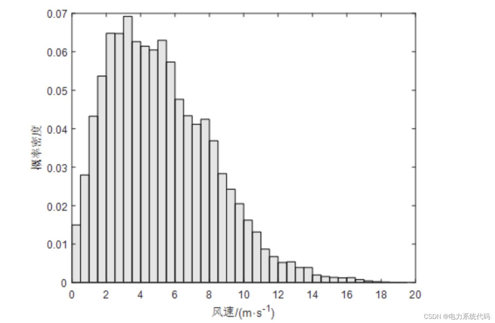
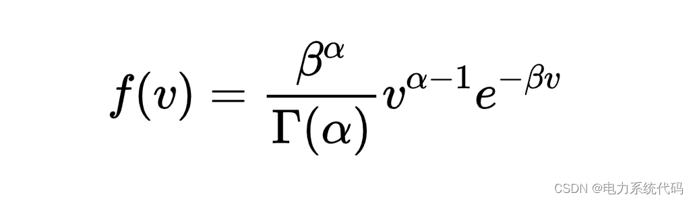
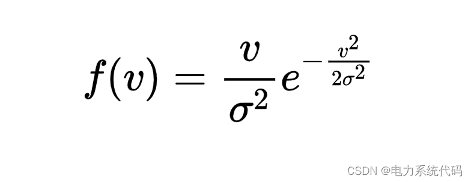
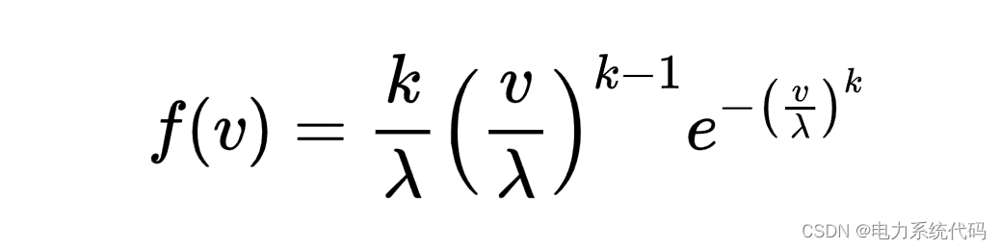
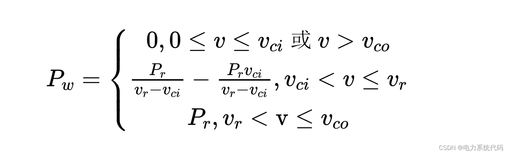
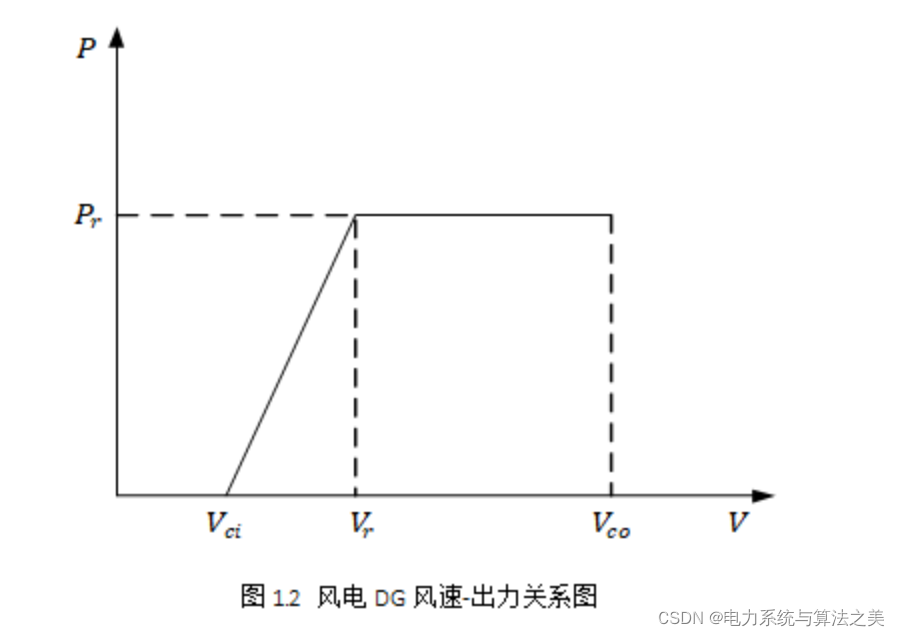
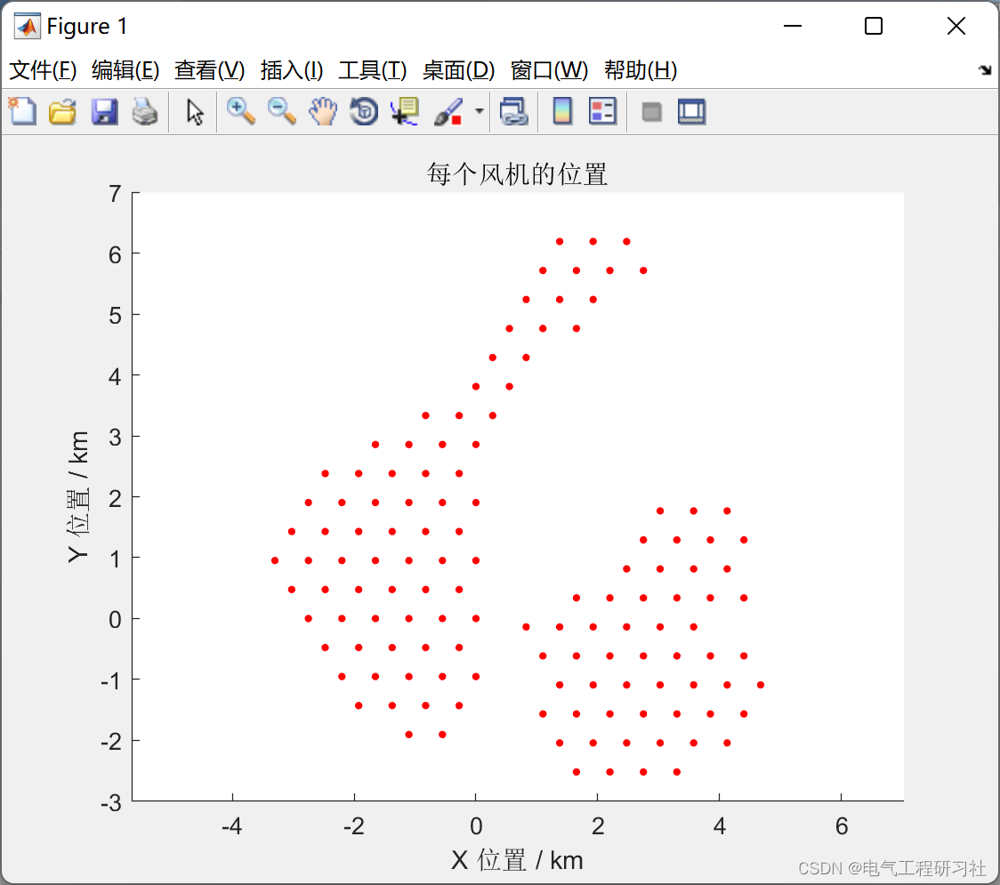
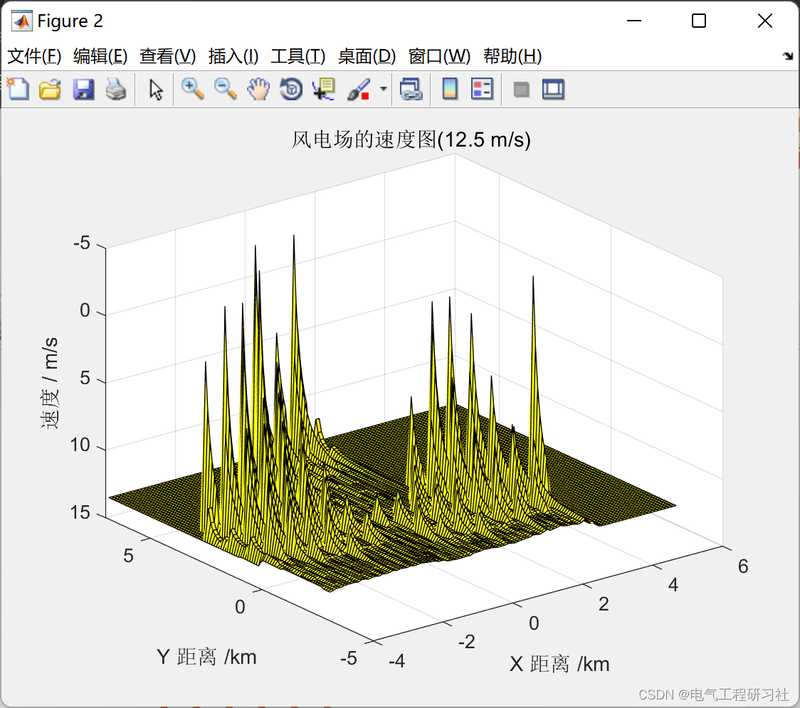
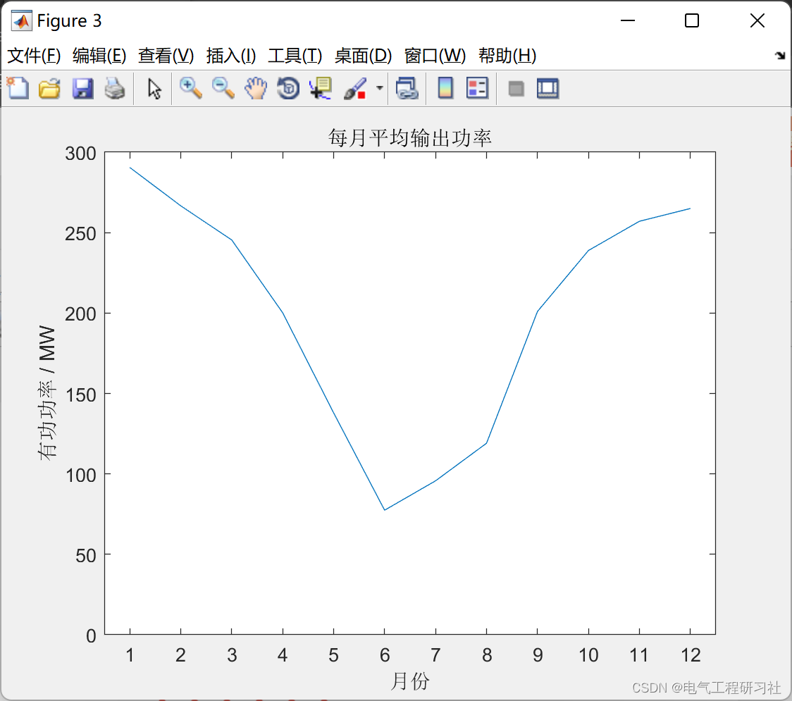
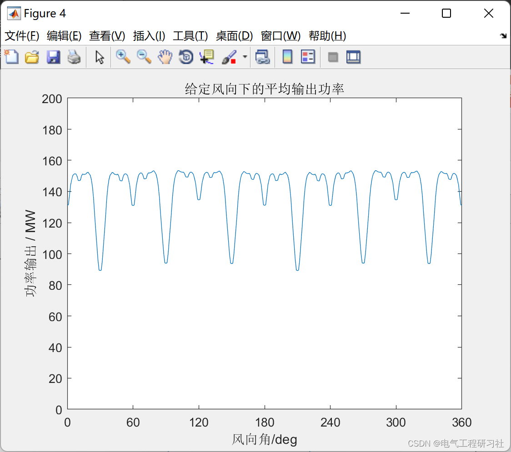

# Monte Carlo-based wind scene model output (Matlab code implementation)

​  
💥💥💥💞💞💞💞 Welcome to this blog❤️❤️❤️💥💥💥
📋📋📋The following is the table of contents.: ⛳️⛳️⛳️​Contents1 Overview2 Wind powerDGEffort Probability Model 2.1 Wind speed distribution characteristics2.2 Wind power DGActive power output3 MatlabImplementation results4 MatlabCode5 End of the note1 Overview  
(1) The expansion of new energy production channels is being squeezed by large-scale development. The capacity and utilization rate are mutually restricting. Massive new energy grid integration. New energy power The proportion of electricity consumption continues to increase. The contradiction between consumption and utilization is prominent: competing for channels with conventional units. The pressure at full power operation of the critical section is relatively high. The wind power anti-peak shaving characteristic is prominent. Aggravate the difficulties of peak-shaving in the power grid. The consumption and utilization are mutually restrictive. On the basis of ensuring consumption levels. There is a downward trend in utilization rate. If there is a 500kV ultra-high voltage transmission line near a large wind farm, The wind utilization rate of this wind farm can be basically achieved to be close to 100%. Can be transmitted to a distance through ultra-high voltage lines. If there is no ultra-high voltage line, Only beneficiaries can be absorbed locally.Additionally, new energy can only generate active power. Due to the power angle factor, Sometimes trends do not flow in the direction we want them to. If some of it flows to other areas. Some areas require the installation of large reactive power devices. Form a "section". Do not let new energy flow through. (2) There are many uncontrollable factors in the output of new energy. The uncertainty of power balance is relatively large. The output of wind and solar energy is affected by weather conditions. Climate has a significant impact. Short-term The medium and long-term power supply is in a state of unpredictability. Subject to the prevailing wind direction. Wind power Impacted by factors such as light intensity, The output of the wind and light is random. Volatility Characterized by intermittency, New energy generation fluctuates daily; Under extreme weather conditions such as cold snaps or consecutive sunny high temperatures, The demand for electricity has surged. However, the minimum output of new energy may be at a lower level. Insufficient balance support capability.(3) Decrease in equivalent rotational inertia of the system. Frequency regulation and stability issues highlight the scale of new energy grid integration. The proportion of young individuals is continuously increasing. Regular units are being replaced by a large number of power electronic devices. The system's rotational inertia continues to decrease. Frequency regulation capability has significantly decreased. The power grid faces the risk of frequency overlimit or even stability damage. August 2019 A major power outage occurred in London, UK. Loss load is about 930,000 kilowatts. Approximately 1 million people were affected by the power outage. This is since the "London blackout" in 2003. The largest scale in the UK. The most impactful power outage incident!Upon analysis, The cause of the accident is that the proportion of wind power new energy installation capacity reached 34.71%. The system's equivalent rotational inertia is insufficient. The system frequency sharply drops to 49Hz after the unit is disconnected continuously. Low-frequency load reduction action. Power outage caused by 5% load reduction. (4) Decrease in reactive power support capability. Voltage control and stability issues are prominent, on one hand, due to insufficient voltage regulation capabilities of new energy sources. The difficulty of voltage control in large-scale new energy grid connection areas, on the other hand, is due to the insufficient dynamic reactive power support capacity in high proportion receiving areas. System voltage regulation capability continues to decline. System security faces the risk of voltage instability. Direct current and new energy units do not possess the dynamic reactive support capability of conventional power sources. With the influx of a large amount of DC power at the receiving end, New energy is rapidly increasing. The dynamic reactive reserve of the system has sharply decreased.Voltage stability issues induced by faults in ultra-high voltage direct current (UHV DC) systems. For the sending end of the power grid, it manifests as overvoltage. For the receiving end of the power grid, it manifests as a continuous low voltage or even voltage collapse. The system faces the risk of widespread power outages. (5) Cross-region AC/DC coupling faults are globalized. Non-I frequency stability issues have emerged with the expansion of new energy grid integration and the rapid development of ultra-high voltage AC/DC interconnections. Under the impact of disturbance events, The energy absorption and release characteristics of the system are more complex. Presents a new form. Deliver The receiving grid is closely coupled with both AC and DC. The grid has a distinctly integrated feature. The dynamic interaction characteristics of cross-region AC/DC are more complex. Local transient energy shocks can easily lead to global stability issues.The large-scale grid connection of new energy sources leads to a more complex grid stability pattern, and the rapid response characteristics of power electronic devices cause non-I frequency instability issues. 2 Wind Power DG Probability Model 2.1 Wind Speed Distribution Characteristics The active power output of wind turbines is related to the wind speed at their location. For actual measured wind speed data, it is particularly important to use effective methods to fit to obtain relatively accurate probability distribution characteristics.
Editor
The above figure shows the annual measured wind speed data from a wind power station. It is evident from the graph that the wind speed has certain distribution characteristics: skewed. This paper employs Weibull distribution, Rayleigh distribution, and Gamma distribution to fit the measured wind speed data. (1) Gamma distribution
Probability density function:
​
In this formula, ​ represents wind speed (m/s), ​ represents the Gamma function, α and β are parameters of the Gamma distribution. The determination of these parameters is based on fitting actual data. This paper uses the Gamma distribution, but it can also be replaced with the following two distributions.
wt_samp = gamrnd(c_wt, k_wt, 1, times); % Wind speed samples generated from a gammer distribution with shape (1, times,)
% wt_samp = wblrnd(c_wt, k_wt, 1, times); % Wind speed samples modified to be from a Weibull distribution with shape (1, times,)
(2) Rayleigh distribution
Probability density function:
Editor
In the formula: â€" Editorial is wind speed (m/s). Edit to Rayleigh distribution parameters. The determination of parameters is based on the fitting of actual data.
The Rayleigh distribution is a special case of the Weibull distribution, and it is commonly used for long-term (above one year) wind speed data. The fitted results have an error of 10% compared to the actual results.
(3) Weibull distribution
Probability density function:
Editor
In the formula: â€" Editorial is wind speed (m/s). Editor Edited to Weibull Two parameters of distribution. The determination of parameters is based on the fitting of actual data.
The Weibull distribution is widely used, simple in form, and easy to calculate. However, its disadvantage is that it cannot accommodate the wind speed distribution of extreme weather conditions in certain regions.
2.2 Wind power DG active output needs to be obtained after the wind speed model, and then obtain the formula of wind turbine output and wind speed:
Editor
In the formula: â€" Editorialized as wind speed. Edit to cut in wind speed. Edit to cut out wind speed. Editor, For the rated wind speed of wind turbine units. Edit to the rated output power of wind turbine units.
Editor
3. MATLAB implementation results editing
Editor
Editor
Editor
4. The Matlab code in this article only displays a part of the code, the full code can be found in:
figure;plot(windDirections,anglePower*10^(-6));\naxis([0 360 0 200]);\nxticks(0:60:360);\nxlabel('Wind direction/deg')\nylabel('Power output / MW')\ntitle('Average output power under given wind direction')\n  
5. References to theoretical literature in the final section, including online sources, should be removed by contacting the blogger for removal of any infringement.

## Images

<!-- PAYMENT_BLOCK -->

## Get this dataset

- Payment link (Stripe): [Buy now](https://buy.stripe.com/3cs8yP7sY87d0vu9AB)
- Payment QR code: 

<!-- /PAYMENT_BLOCK -->
